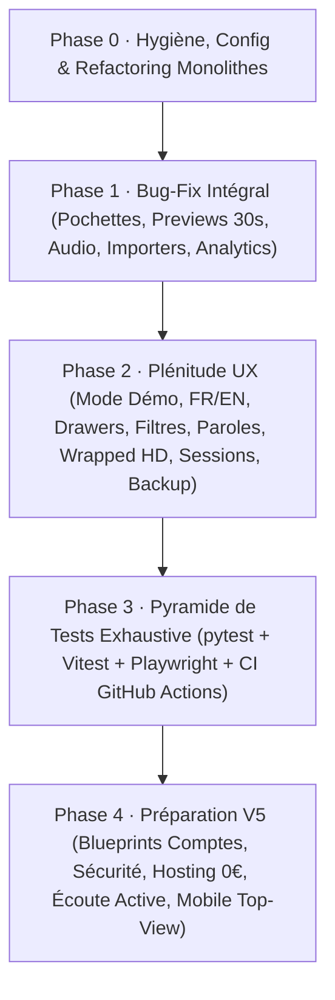

# AMDataWrap V4.5 — Spécification Finale Validée (Post `/grill-me`)

> **Statut :** Validé par `/grill-me` · **Date :** 2026-11-22  
> **Cible :** Consolider `frontend-v4.1/` + `backend/` en une **V4.5** sans bug, ultra-optimisée, couverte à 100 % par des tests (back + front + E2E + CI), parfaitement utilisable (Mode Démo, FR/EN, Drawers, Filtres, Paroles, Wrapped HD, Sessions/Historique) et architecturalement prête pour la future mise en ligne **V5** (0 €/low-cost, PC & Mobile navigateur).

---

## 1. Décisions d'Architecture & Stratégie Git

| Axe | Décision Validée |
| :--- | :--- |
| **Stratégie de branches** | `dev` conserve tout l'historique et tous les anciens frontends (`frontend/`, `v2`, `v3`, `v4`, `v4.1`). `main` ne contiendra pour la mise en ligne qu'**un seul frontend** (le dernier) + `backend/`. |
| **Direction artistique** | Unique thème sombre **« Salon d'écoute / Liner Notes »** ultra-poli (contraste, focus clavier, responsive propre). *(Mode Clair APCA reporté en V5).* |
| **Langues (i18n)** | **Sélecteur FR / EN** intégré dès la V4.5 sur toute l'interface (couche i18n légère sans dépendance lourde). |
| **Premier lancement** | Écran d'accueil guidé + **Mode Démo 1-clic** (bibliothèque synthétique réaliste pour explorer Salon 3D + tous les onglets sans importer de ZIP et sans écraser les vraies données). |
| **Mobile (3D)** | En V4.5 : responsive impeccable sur les onglets analytiques. **À préparer (blueprint, pas implémenté)** : désactivation de la salle 3D navigable sur mobile au profit d'une **Top-View** simplifiée (bac + tourne-disque). |
| **Hors-scope V4.5 (reporté V5)** | Implémentation Auth/Login prod, File d'attente + Playlists Harmoniques, Blind-Test, Iceberg, Boussole Russell, Mode Clair, implémentation Mobile Top-View. |

---

## 2. Plan d'Exécution Détaillé par Phases

### Phase 0 — Refactoring Structurel, Hygiène & Fondations Non-Cassantes
1. **Configuration centralisée (`backend/app/config.py`)** :
   - Lecture `.env` / variables d'environnement (`AMDW_CORS_ORIGINS`, `AMDW_DB_PATH`, `AMDW_ARTWORK_CACHE_DIR`, `AMDW_ENV`, etc.) avec valeurs par défaut locales identiques à l'actuel.
   - Durcissement SSRF sur `/api/artwork-proxy` et `/api/audio-proxy` (validation stricte schéma/hôte/DNS privé + timeouts & taille max de réponse).
   - Hook `user_id: int = 1` non-cassant dans le contexte de filtrage pour préparer l'isolation multi-tenant V5.
2. **Découpage des monolithes** :
   - `frontend-v4.1/src/scene/PersistentStageCanvas.tsx` (2 659 L) → modules dédiés (`scene/StageEngine.ts`, `scene/TurntableRig.ts`, `scene/VinylCrateRig.ts`, `scene/SleeveInspector.ts`, `scene/RoomRig.ts`, `scene/RaycastController.ts`).
   - `backend/app/analytics/v3_science.py` (1 861 L) → sous-modules (`science_metrics.py`, `eras_pelt.py`, `camelot_playlists.py`, `atlas_geo.py`, `iceberg_games.py`) en conservant les ré-exports pour 100 % rétrocompatibilité.
   - `backend/app/main.py` (911 L) → séparation propre en routers (`analytics_router`, `external_router`, `proxy_router`, `system_router`).
3. **Hygiène Frontend** :
   - Suppression de la dépendance morte `echarts` dans `frontend-v4.1/package.json`.
   - Typage TypeScript strict des contrats API (élimination des `useApi<any>` critiques).

---

### Phase 1 — Bug-Fix Intégral & Fiabilisation (Pochettes, Extraits, Audio, Importers, Analytics)
1. **Pochettes (`artwork_url` & `/api/artwork-proxy`)** :
   - Audit complet des cas de pochettes manquantes, floues ou 404.
   - Cascade fallback robuste côté backend : **iTunes HD (`600x600bb`) → Deezer (`cover_xl`) → Cover Art Archive** avec cache disque léger + `ETag`/`304` + retry contrôlé.
   - Côté front : gestion d'erreur `<Cover />` avec fallback propre (jamais d'image brisée) et chargement progressif fluide.
   - Bouton **« Réparer / Rafraîchir les pochettes & extraits manquants »** dans `Archives` (ré-interroge les entrées incomplètes ou cassées).
2. **Extraits 30 s & Lecture Audio (`playback.py`, `playTrack.ts`, `HybridPlaybackDeck.tsx`, `amdatawrap-bridge`)** :
   - **Fix critique des previews Deezer expirées** : les URLs signées `cdns-preview-*` expirent après ~15–60 min. Ajouter un rafraîchissement transparent côté backend (`/api/v4/playback/refresh-preview`) ou fallback automatique iTunes quand une preview renvoie `403`/`404`.
   - Fiabilisation du matching YouTube (`ytmusicapi` : éviter les versions live/karaoké/covers) et de la synchro volume / horloge / bras 3D / enchaînement des pistes & faces.
   - Auto-reconnexion WebSocket du Bridge MV3 (backoff exponentiel) + indicateur clair de l'état connecté.
3. **Importers Multi-Plateformes & Enrichissement** :
   - Audit et tests de régression sur les 5 parseurs (Apple Music, Spotify Extended/Account/TechLogs, YouTube Takeout JSON/HTML, Deezer `.xlsx`, TIDAL/CSV) : dates/fuseaux, genres/années manquants, déduplication.
   - **Pastille de statut Enrichissement Passe 2 (SSE `/api/enrichment/stream`) & Atlas (`/api/v3/jobs/status`)** dans l'interface avec possibilité de Pause/Relancer.
4. **Audit complet des 11 Onglets Analytiques** :
   - Vérification de chaque calcul, état vide, bouton `Play`, lien de navigation et layout responsive (Desktop, Tablette, Mobile).

---

### Phase 2 — Plénitude UX & Utilisabilité Grand Public
1. **Premier Lancement & Mode Démo 1-clic** :
   - Si `has_data === false` (base vide), afficher un écran d'accueil clair : *Importer mon archive* OU **« Explorer avec une bibliothèque de démo »**.
   - Endpoint `POST /api/v4/demo/load` (génère un profil démo isolé réaliste avec artistes/albums/sessions/paroles/géoloc en < 1 s, supprimable en 1 clic).
2. **i18n Légère FR / EN** :
   - Module `src/i18n/` (`fr.ts`, `en.ts`, hook `useT()`, sélecteur `FR | EN` dans le header persisté en `localStorage`, formatage dates/nombres adapté à la locale).
3. **Drawers Contextuels Universels (`DetailDrawer.tsx`)** :
   - **Drawer Artiste** (`/api/detail/artist/{key}` + `/api/external/artist-bio` Wikipédia) : KPIs, bio, évolution mensuelle, meilleure journée (cliquable), top albums & titres avec `Play`.
   - **Drawer Album** (`/api/detail/album/{key}`) : pistes, stats + bouton **« Poser sur la platine 3D »**.
   - **Drawer Journée** (`/api/detail/day/{date}`) : timeline chronologique complète de la journée (branchée sur la Heatmap de `ChronoPage` et la Journée Record d'`OverviewPage`).
4. **Barre de Filtres Avancés Repliable (`Filtres +`)** :
   - Header épuré conservé (Plateforme + Année + `h/min` + `FR/EN`), enrichi d'un tiroir `Filtres +` donnant accès à : Mois, Saison, Plage personnalisée, Règle de skip (`Last.fm` / `Toutes` / `Custom`), Métrique (`Temps` ↔ `Écoutes`), Genre, Appareil, Hors-ligne, Exclure Incognito.
5. **Paroles Synchronisées (LRCLIB) & BPM (Deezer) dans le Lecteur** :
   - Bouton discret « Paroles » dans `HybridPlaybackDeck` ouvrant un panneau propre avec défilement synchronisé sur `playbackClock` (via `/api/external/lyrics`) + badge BPM (`/api/external/track-bpm`).
6. **Wrapped Collector Complet & Export PNG HD** :
   - Enrichissement de `WrappedPage` (chapitres complets, bande-son auto optionnelle) + **Export PNG HD (2.5×)** en 2 formats : *Poster Collector* & *Ticket de Caisse Musical*.
7. **Sessions & Historique Complet Virtualisé** :
   - Nouvelle vue (ou sous-onglet de `Rythmes` / `Recherche`) branchée sur `/api/sessions`, `/api/history` (liste virtualisée fluide sur 50k+ écoutes) et **Export CSV** (`/api/history/export.csv`).
8. **Gestion Granulaire des Données & Portabilité (`HubPage`)** :
   - Supprimer **1 profil** ou **1 source importée** spécifique (avec recompute propre des exclusions fusionnées + Parquet).
   - **Export / Import d'une sauvegarde portable** de profil (`.amdw.json.gz` / `.json`) prête pour la future migration vers la version en ligne.

---

### Phase 3 — Pyramide de Tests Exhaustive & CI GitHub Actions
1. **Backend `pytest` (couverture complète par module)** :
   - Tests unitaires dédiés pour : `normalize.py`, `filters.py`, `ingestion.py`, chacun des 5 `importers/`, `profiles.py` (fusion ISRC ±180 s, suppression granulaire, backup/restore), `enrichment.py` & `vinyl_enrichment.py` (mock HTTP), `playback.py` (refresh preview, resolve), `duckdb_engine.py`, `analytics/*`, `external.py`, `artwork-proxy` / `audio-proxy` (SSRF + ETag 304), `demo/load`.
   - Conservation de `test_properties.py` (Hypothesis) & `test_openapi_fuzz.py` (Schemathesis).
2. **Frontend `Vitest` + `@testing-library/react`** :
   - Tests unitaires sur : `useV4Store`, `api/client.ts` (`buildQueryParams`, formatters), `i18n`, `playbackClock`, `playTrack`, `textures.ts` (groove math), composants UI (`Cover`, `InfoTooltip`, `DetailDrawer`, `FilterDrawer`) et rendu des pages principales.
3. **Playwright E2E (`frontend-v4.1/e2e/`)** :
   - Scénarios complets : Mode Démo, switch FR/EN, 12+ onglets, Drawers Artiste/Album/Jour, Filtres avancés, Paroles, Wrapped Export, Sessions/Historique, et budgets perf WebGL (`calls < 120`, `textures <= 16`, `rafActive === false`, 0 erreur console, 0 HTTP ≥ 400).
4. **CI GitHub Actions (`.github/workflows/ci.yml`)** :
   - Déclenché sur `push` / `pull_request` : `pytest` (backend) + `tsc --noEmit` + `vitest run` + `vite build` (frontend) + rapport de taille de bundle.

---

### Phase 4 — Préparation V5 (Dossiers d'Architecture dans `docs/v5-prep/`)
Aucun déploiement ni auth prod codé en V4.5, mais **5 blueprints complets prêts à exécuter en V5** :
1. **`01_USER_ACCOUNTS_AUTH.md`** : Modèle `users`, Auth sans friction (Magic Link / OAuth Google/GitHub), isolation multi-tenant `user_id`, migration depuis sauvegarde `.amdw` locale.
2. **`02_SECURITY_OWASP.md`** : Checklist sécurité prod (CSP strict, CORS whitelist, rate limiting IP/user, quotas taille ZIP, scan/validation fichiers, durcissement SSRF, politique RGPD & suppression de compte).
3. **`03_FREE_LOWCOST_HOSTING.md`** : Architecture cible **0 € / très bas coût** pour navigateur PC & Mobile (Frontend sur Cloudflare Pages / Vercel gratuit, Backend conteneurisé Fly.io / Render / VPS léger, BDD Turso/LibSQL ou Postgres Free Tier, cache partagé métadonnées/pochettes R2/KV pour éviter les rate-limits iTunes/MusicBrainz).
4. **`04_FREE_LIVE_TRACKING_PER_PLATFORM.md`** : Matrice d'au moins **1 solution gratuite et simple par plateforme** (Apple Music, Spotify, YouTube Music, Deezer, TIDAL) : scrobbles ListenBrainz/Last.fm/Pano Scrobbler/Web Scrobbler + appairage `wss://` par code/token pour l'extension MV3 (et publication Chrome Web Store).
5. **`05_MOBILE_TOP_VIEW_SPEC.md`** : Spécification UX/UI & technique du mode mobile (désactivation de la salle 3D navigable sur petits écrans → **Top-View 2D/2.5D ultra-légère** avec bac horizontal tactile + platine vue de dessus).

---

## 3. Critères de Validation Finale (« Definition of Done » V4.5)
- [ ] **0 bug connu** sur pochettes, extraits 30 s, lecture YouTube/Bridge, importers 5 plateformes et calculs analytiques.
- [ ] **100 % des modules critiques** couverts par `pytest` (backend) et `Vitest` (frontend) + E2E Playwright verts + CI GitHub Actions active.
- [ ] **Mode Démo + FR/EN + Drawers + Filtres avancés + Paroles LRCLIB + Wrapped HD PNG + Sessions/Historique + Suppression granulaire & Backup** fonctionnels.
- [ ] **Budgets perf V4.1 maintenus ou améliorés** (RAM repos ≤ 120 Mo, GPU idle 0 Hz, RSS backend ≤ 130 Mo).
- [ ] **5 blueprints V5** rédigés et prêts dans `docs/v5-prep/` + branche `dev` / `main` prête pour la mise en ligne.
